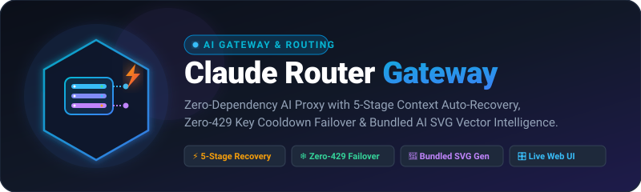
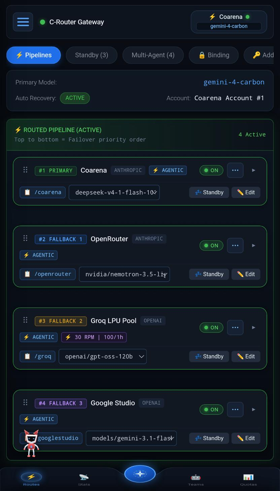
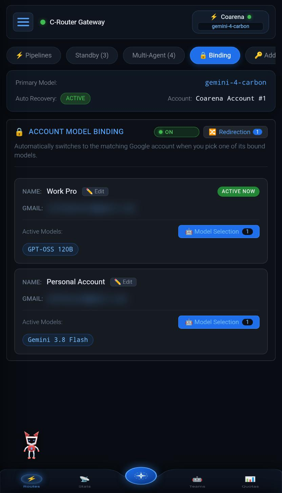
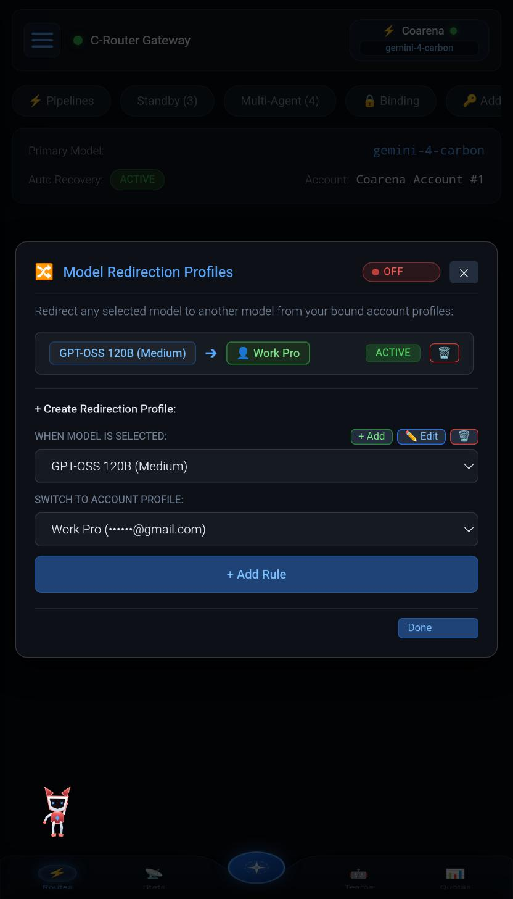

<div align="center">



<p align="center">
  <b>Zero-Dependency AI Gateway, 5-Stage Context Recovery & Key Failover Proxy</b>
</p>

[](https://github.com/myfunuiai-del/claude-router)
[](https://github.com/myfunuiai-del/claude-router)
[](https://github.com/myfunuiai-del/claude-router)
[](https://github.com/myfunuiai-del/claude-router)

</div>

---

## 📖 Overview

**Claude Router** is a high-speed, **zero-dependency** local AI proxy gateway and orchestration manager engineered specifically for **Claude Code**, **Antigravity**, **Aider**, and any Anthropic or OpenAI API compatible CLI/IDE.

It consolidates multiple AI providers (Google AI Studio, Groq, Mistral, OpenRouter, Coarena, Ollama, etc.) behind a single local proxy endpoint (`http://127.0.0.1:8999/api`). It features a touch-optimized mobile Web Console (`http://127.0.0.1:8999/ui`), real-time token/speed meters, dynamic key rotation, intelligent rate-limit cooldowns, and bundled SVG AI vector intelligence.

---

## 📱 Mobile Web Console Preview

<div align="center">
  <table>
    <tr>
      <td align="center" width="33%">
        <br/>
        <b>⚡ Routed Pipelines & Mascot</b>
      </td>
      <td align="center" width="33%">
        <br/>
        <b>🔒 Account-Model Binding</b>
      </td>
      <td align="center" width="33%">
        <br/>
        <b>🔀 Redirection Profiles</b>
      </td>
    </tr>
  </table>
</div>

---

## 🛠️ Built With / Tech Stack

Claude Router is crafted with a strict **zero external dependency** standard to ensure instant execution across low-resource mobile environments (Android Termux) and modern Linux servers:

| Layer | Technologies & Components | Architecture Details |
| :--- | :--- | :--- |
| **Backend Core** | **Python 3.8+ (Standard Library Only)** | Powered purely by native `http.server`, `urllib.request`, `socketserver`, and `json`. Zero `pip install` required. |
| **Streaming Engine** | **Async SSE / Chunked HTTP** | Bidirectional protocol transformation (`tool_use` ↔ `tool_calls`, `thought_signature`, streaming chunks). |
| **Frontend UI** | **Vanilla HTML5, Modern CSS3 & Vanilla JS** | Pure client-side reactive dashboard with glassmorphism dark-mode UI, touch-safe drag-and-drop, and live status polling. |
| **Resilience System**| **5-Stage Context Heuristic Trimmer** | Automatically bypasses upstream WAF/payload limits (400/413) without altering actual user chat history. |
| **Bundled Skills** | **SVG Vector AI & Automation Scripts** | Integrated `svg-generator` skill bundle for instant prompt-to-SVG vectorization without cloud image bloat. |

---

## ✨ Key Features & How Each One Works

### 1. ⚡ Dual-Pool Priority Routing & Multi-Model Fallback
- **⚡ ROUTED PIPELINE (ACTIVE):** Requests try enabled servers strictly from top to bottom (`#1 PRIMARY` ➔ `#2 FALLBACK 1` ➔ `#3 FALLBACK 2` ...). Before failing over to the next priority server, each server sequentially tries **all of its configured models** so healthy models on your primary server are exhausted first.
- **💤 STANDBY / FREE POOL (Strict Isolation):** Reserve servers kept out of the automatic failover chain. Dedicated requests sent to a standby route (e.g. `http://127.0.0.1:8999/googlestudio`) stay **strictly isolated** within that server without cascading into the active routed pipeline.
- **Direct Provider Routes (`/{provider_id}`):** Every server exposes its own direct route (e.g. `http://127.0.0.1:8999/coarena`). Tap the `📋 /provider` pill on any card to copy its direct URL.

### 2. 🤖 Multi-Agent Architecture Mode (Preset Teams & Chat Dropdown Sync)
- **Custom Mix Teams (Role-Based Orchestra):** Build teams consisting of multiple servers and specific models (e.g., `Architect: Coarena gemini-4-carbon` + `Coder: Groq gpt-oss-120b`).
- **Live Chat Dropdown Integration:** Every saved team automatically synchronizes directly into your chat box model selector (`~/.claude/agy_providers.json`) under **`🤖 MULTI-AGENT TEAMS`** with its full composition shown.
- **Strict All-or-Nothing Isolation Policy:** If **any single member** of the selected team is turned OFF, lacks keys, or throws an error/rate limit, the request **strictly halts with HTTP 503** explaining exactly which member failed. It **never leaks** into general fallback servers.

### 3. 🤖 Modern Engine Modes (`⚡ Agentic` vs `💬 Normal`)
- Available for **both Anthropic and OpenAI** protocol servers:
  - **`⚡ Agentic` Mode (Default):** Full bidirectional tool calling (`tool_use` / `tool_result` ↔ `tool_calls` / `role: "tool"`), streaming tool call assembly, `tool_choice`, thinking/reasoning blocks, strict OpenAI `tool_call_id` normalization, JSON Schema sanitization, and bidirectional **Gemini 3.x `thought_signature` round-trip caching**.
  - **`💬 Normal` Mode:** Strips heavy agent/coding tool definitions to save ~10k+ tokens per request while **preserving interactive clarification question tools** (`ask_question`, etc.).

### 4. 🛡️ Context-Preserving 5-Stage Auto History-Recovery
When a long chat hits an upstream firewall/WAF or payload-size block (**HTTP `400` / `403` / `413`**), the router recovers the chat **without forcing you to open a new chat** and **without mutating your original chat history**:

| Stage | What It Sends | Why It Helps |
| :--- | :--- | :--- |
| **Original** | Full untouched chat history | Normal path (zero overhead when no error occurs) |
| **Stage 1** | Full history + **untouched last message**, shrinking only **older large `tool_result` outputs** | Keeps 100% of your conversation context intact while removing giant old logs/HTML dumps |
| **Stage 2** | Full history with **all large tool outputs & text blocks shrunk** | Recovers even when recent turns contain huge tool outputs |
| **Stage 3** | **Recent 3–5 turns** + compact **session summary** of earlier omitted history | Preserves conversation continuity while drastically reducing payload size |
| **Stage 4** | **Last assistant response + last user message** paired with full **session summary context** | Recovers extreme context-limit/WAF cases while keeping the agent aware of the prior step |
| **Stage 5** | Bare last message fallback ➔ **untouched full request** failover to next `ON` server | Seamless failover across providers if the current server refuses all stages |

### 5. ❄️ Smart API Key Auto-Cooldown & Sticky 429 Auto-Retry
- **Sticky Key Pointer & Instant 429 Switch:** Tracks the last healthy key per provider. When a key hits `429` (Rate Limit / Daily Quota), `401`, or `402`, the pointer immediately advances to the next healthy key and **auto-retries the request transparently**.
- **`HTTP 401` (Invalid / Revoked Key):** Placed on a **10-minute** cooldown across all models.
- **`HTTP 429` (Rate Limit / Daily Quota):** Placed on a **3-minute** cooldown (or **30-minute** cooldown if daily quota exhaustion is detected).
- **`HTTP 402` (Payment Required / Paid Model):** Only that specific **`(key + model)`** pair is placed on a **5-minute** cooldown.

### 6. 📱 Mobile-First Gateway UI, Fox-Mecha Mascot & Offline Local Brain
- **Touch-Optimized Mobile Architecture:** Curved sticky bottom navigation bar (`Routes`, `Stats`, futuristic **Gateway Core SVG** radial FAB, `Teams`, `Quotas`), swipeable horizontal lane pills, slide-out quick-settings drawer, and full **Android hardware Back button** support for closing modals/sheets/drawers.
- **Custom Dark Bottom-Sheet Pickers & In-UI Modals:** Replaces native browser dropdowns, `prompt()`, and `confirm()` dialogs with sleek dark-mode bottom sheets and action modals.
- **Interactive Origami Fox-Mecha Mascot:** Physics-based companion featuring 2-part articulated limbs, swaying jetpack flight, mid-air hovering, smooth rising/settling gestures, and cursor-following walking on focused text boxes (with impatient arms-crossed foot-tapping when idle and annoyed walk-back on delete).
- **🦊 Fox-Mecha AI Persona (Online & On-Demand Local LoRA Engine):**
  - **Online Mode:** Connects to free cloud providers (Google AI Studio, Groq) with intelligent system prompts, dynamic tool action generation, micro-motions, and persistent memory.
  - **Offline Local LoRA Engine:** Bundled with a custom fine-tuned **`fox_lora.gguf`** (8.3 MB) adapter. On-demand one-click download for base `Qwen2.5-0.5B` (~320 MB) directly from the Web Console settings card.
  - **Safe Remove & 10-Second Undo:** Easily delete the downloaded local base model file anytime with in-UI confirmation and an interactive 10-second countdown Undo toast.

### 7. 🔒 Account-Model Binding & Model Redirection Profiles
- **Auto-Detect Local Accounts:** Automatically detects configured AntiGem Google accounts without hardcoding personal credentials.
- **Model-to-Account Binding:** Bind specific model families to dedicated Google accounts with automatic background token switching.
- **Redirection Profiles (+Add / Edit / Delete + 10s Undo):** Map any trigger model to a target account profile with custom in-UI dark modals, confirmation dialogs, 10-second live Undo bar, and **Switch-Only (0 Quota)** proxy handling.

### 8. 🎨 Bundled Skills & Image Generation Policy Auto-Setup
- **Auto-Sync `svg-generator` Skill:** When `crouter` runs, it automatically provisions the `svg-generator` skill into `~/.claude/skills/` and `~/.gemini/config/skills/`.
- **Image Generation Policy:** Automatically sets the policy across `~/.antigem/memory/global/` and `~/.claude/CLAUDE.md`:
  - Disallows `pollinations.ai`.
  - Prioritizes native/local image generation first, with intelligent fallback to Claude + `svg-generator` for scalable SVG vector graphics.

---

## 🚀 Quick Start & CLI Usage

### Install
```bash
git clone https://github.com/myfunuiai-del/claude-router.git ~/.gemini/claude-router
cd ~/.gemini/claude-router
./crouter start
```

### Start Claude Router
```bash
crouter start
```
Starts the background proxy on port `8999` and automatically opens the mobile Web Dashboard.

### Check Status
```bash
crouter status
```

### Stop Router
```bash
crouter stop
```
