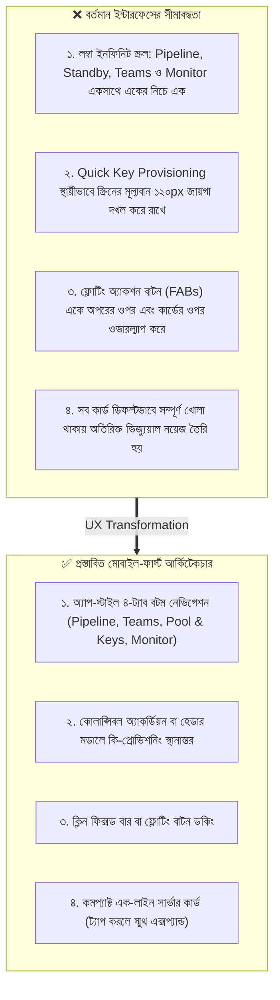
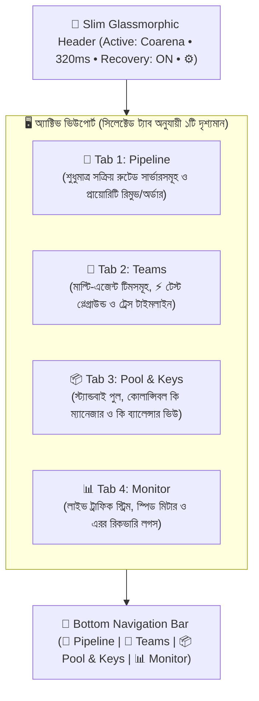
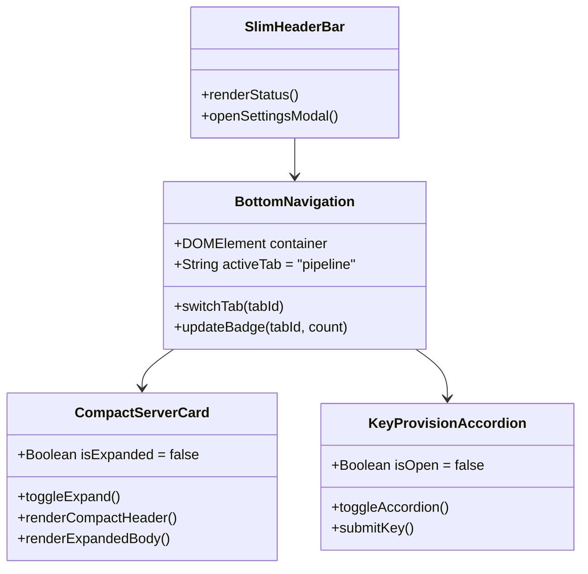
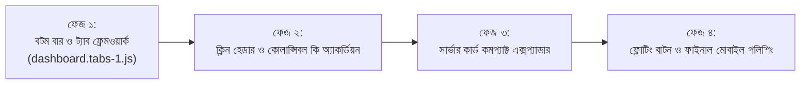

# Claude Router Web Dashboard — Mobile-First UI/UX Redesign Master Plan

> [!NOTE]
> এই মহাপরিকল্পনাটি মোবাইল স্ক্রিনে বিদ্যমান সিঙ্গেল-পেজ ইনফিনিট স্ক্রলিং ও ঘিজীবিজি ইন্টারফেস দূর করে একটি আধুনিক, নেটিভ অ্যাপের মতো ক্লিন, স্লিক ও সাইবারনেটিক ইউজার ইন্টারফেস (UI/UX) গড়ে তোলার জন্য প্রস্তুত করা হয়েছে।

---

## ১. বর্তমান UI-এর সমস্যা বিশ্লেষণ (Problem Statement)

ব্যবহারকারীর শেয়ার করা মোবাইল স্ক্রিনশট ও ড্যাশবোর্ড অডিট অনুযায়ী মূল সমস্যাগুলো:

---

## ২. প্রস্তাবিত নতুন ইউআই আর্কিটেকচার (Target Architecture)

---

## ৩. চারটি মূল ট্যাবের বিস্তারিত স্পেসিফিকেশন (Tab Breakdown)

### ট্যাব ১: 🔀 Pipeline (অ্যাক্টিভ রাউটিং ইঞ্জিন)
* **মূল ফোকাস:** বর্তমানে ট্রাফিক কোন কোন সার্ভারে ফেইলওভার হচ্ছে তা নিয়ন্ত্রণ করা।
* **ফিচারসমূহ:**
  1. **Primary & Fallback কার্ড ভিউ:** কেবল অ্যাক্টিভ রুটেড সার্ভার কার্ডগুলো সাজানো থাকবে (`#1 Primary`, `#2 Fallback 1`, `#3 Fallback 2`)।
  2. **কমপ্যাক্ট কার্ড ডিজাইন (Compact Accordion):**  
     - ডিফল্ট অবস্থায় প্রতিটি কার্ড মাত্র ৪৬ পিক্সেল উচ্চতার হবে: `[::] [#1 PRIMARY] Coarena [⚡ AGENTIC] [🟢 ON] [▼]`
     - কার্ডে ট্যাপ করলে স্মুথ অ্যানিমেশনের মাধ্যমে ড্রপডাউন, মডেল সিলেক্টর, `/coarena` রুট কপি বাটন ও Standby পাঠানোর বোতাম দৃশ্যমান হবে।
  3. **স্বচ্ছ ড্র্যাগ-অ্যান্ড-ড্রপ:** টাচ ড্র্যাগ করে সহজেই প্রায়োরিটি রি-অর্ডার করা যাবে।
  4. **কোনো অতিরিক্ত উপাদান নয়:** স্ট্যান্ডবাই সার্ভার বা কি প্রভিশনিং এই ট্যাবে দেখা যাবে না।

---

### ট্যাব ২: 👥 Multi-Agent (অর্কেস্ট্রেশন ও প্লেগ্রাউন্ড)
* **মূল ফোকাস:** এআই টিম তৈরি, মেম্বারদের মোড টিউনিং ও ড্রাই-রান টেস্ট।
* **ফিচারসমূহ:**
  1. **টিম কার্ডসমূহ:** সুপ্রিম কাউন্সিল, ট্রাই-টিয়ার ইত্যাদি টিমগুলোর স্ট্যাটাস ও অন/অফ সুইচ।
  2. **১-ক্লিক মোড টগল:** মেম্বারের পাশের `⚡` (Agentic) বা `💡` (Normal) আইকনে ক্লিক করে মুহূর্তের মধ্যে মোড পরিবর্তন।
  3. **⚡ Run Test Prompt বাটন:** সরাসরি প্লেগ্রাউন্ড মডাল চালু করে যেকোনো প্রম্পট রান ও মেম্বারদের আউটপুট নিরীক্ষা।
  4. **📥 Import / 📤 Export:** টিম কনফিগারেশন ব্যাকআপ ও রিস্টোর।

---

### ট্যাব ৩: 📦 Pool & Keys (সার্ভার পুল ও কি ব্যালেন্সার)
* **মূল ফোকাস:** নিষ্ক্রিয়/স্ট্যান্ডবাই সার্ভার ও এপিআই কি ম্যানেজমেন্ট।
* **ফিচারসমূহ:**
  1. **কোলাপ্সিবল Quick Key Provisioning অ্যাকর্ডিয়ন:**  
     - ডিফল্ট অবস্থায় এটি একটি স্লিম বোতাম আকারে থাকবে: `[+ 🔑 Quick Provision API Key]`
     - ট্যাপ করলে মসৃণ ড্রপডাউন দিয়ে প্রোভাইডার সিলেক্টর, কি ইনপুট বক্স ও `+ Add Key` বোতামটি ওপেন হবে। কি যোগ করা শেষে আবার স্বয়ংক্রিয়ভাবে কোলাপ্স হয়ে যাবে।
  2. **Standby / Free Pool লেনের সার্ভারসমূহ:**  
     - যে সার্ভারগুলো পাইপলাইনে যুক্ত নেই (`Google Studio`, `AgentRouter` ইত্যাদি)।
     - এক ক্লিকে `⚡ Route` চেপে পাইপলাইনে পাঠানো যাবে।
  3. **স্মার্ট কি ব্যালেন্সার মেট্রিক ব্যাজ:** প্রতিটি প্রোভাইডারের কয়টি কি সক্রিয় এবং বিগত ৬০ সেকেন্ডের আরপিএম/টিপিএম কত তা সংক্ষেপে দেখা যাবে।

---

### ট্যাব ৪: 📊 Live Monitor (টেলিমেট্রি ও লগস)
* **মূল ফোকাস:** লাইভ ট্রাফিক নিরীক্ষণ ও রিকভারি স্টেজ পর্যবেক্ষণ।
* **ফিচারসমূহ:**
  1. **রিয়েল-টাইম রিকোয়েস্ট টেবিল:** মেম্বার বা সার্ভার কে রেসপন্স দিচ্ছে, লেটেন্সি কত (ms), টোকেন সংখ্যা ও রেসপন্স কোড।
  2. **🔍 Trace বাটন:** মাল্টি-এজেন্ট রিকোয়েস্টের পূর্ণাঙ্গ স্টেপ-ট্রেস টাইমলাইন ড্রয়ার।
  3. **টোকেন ও স্পিড মিটার:** প্রতি সেকেন্ডে কত টোকেন প্রসেস হচ্ছে (TPS)।
  4. **অটো-স্ক্রল পজ/রিজিউম টগল:** স্ক্রলিং থামাতে বা চালু রাখতে বোতাম।

---

## ৪. ইউআই কম্পোনেন্ট রি-ডিজাইন ও সাইবারনেটিক স্টাইলিশ লুক

### ১. স্লিম গ্লাস হেডার (Slim Glassmorphic Header)
- স্থায়ী উচ্চতা: ৪৪ পিক্সেল (`height: 44px; backdrop-filter: blur(12px);`)
- বামে: `Coarena • 320ms • 🟢 Recovery`
- ডানে: `[⚙️ Settings]` ও `[🔄 Sync]` আইকন।

### ২. অ্যাপ-স্টাইল বটম বার (Fixed Cybernetic Bottom Bar)
- মোবাইলের নিচে ফিক্সড থাকবে (`position: fixed; bottom: 0; left: 0; width: 100%; z-index: 1000;`)
- ব্যাকগ্রাউন্ড: ডিপ স্লেট গ্লাস (`rgba(13, 17, 23, 0.92)`) সাথে ১ পিক্সেল সাইবারনেটিক নিয়ন বর্ডার।
- অ্যাক্টিভ ট্যাবে থাকবে সুন্দর পার্পল/সায়ান গ্লো এফেক্ট (`text-shadow: 0 0 10px #79c0ff;`)।

### ৩. ফ্লোটিং বাটন (FABs) ফিক্স
- ওভারল্যাপিং দূর করে একক ডকড অ্যাকশন বাটন অথবা বটম বারের ঠিক ওপরে মার্জিন রক্ষা করে রাখা হবে।

---

## ৫. ৫০০-লাইন মডুলার নীতি ও ফাইল ইমপ্যাক্ট বিশ্লেষণ

`gemini.md` Rule 2 অনুযায়ী কোনো ফাইলেই ৫০০ লাইনের বেশি কোড থাকবে না। নতুন ইউআই আর্কিটেকচারের জন্য ফাইল পরিকল্পনা:

| মডিউল ফাইল | বর্তমান লাইন | প্রস্তাবিত রূপান্তর | প্রত্যাশিত লাইন | নিয়ম যাচাই |
|:---|:---:|:---|:---:|:---:|
| `dashboard.html` | ৪৮৪ | ৪টি সেকশনকে ডেডিকেটেড ট্যাব কন্টেইনারে সাজানো ও বটম বার যুক্ত করা | ~৪৬০ | ✅ < ৫০০ লাইন |
| `dashboard.styles-1.css` | ৪৮৩ | অতিরিক্ত অব্যবহৃত সিএসএস ক্লিন করে বটম বার ও অ্যাকর্ডিয়ন স্টাইল যোগ | ~৪৬০ | ✅ < ৫০০ লাইন |
| `dashboard.tabs-1.js` *(নতুন মডিউল)* | - | ট্যাব সুইচিং লজিক, স্টেট সংরক্ষণ (localStorage) ও সোয়াইপ হ্যান্ডলার | ~১২০ | ✅ < ৫০০ লাইন |
| `dashboard.servers-1.js` | ৪৪৫ | সার্ভার কার্ডের কমপ্যাক্ট মোড ও এক্সপ্যান্ডেবল টগল যুক্ত করা | ~৪৬০ | ✅ < ৫০০ লাইন |
| `dashboard.teams-1.js` | ২৯১ | অপরিবর্তিত থাকবে (টিম লেনের এক্সিস্টিং লজিক অক্ষুণ্ণ) | ২৯১ | ✅ < ৫০০ লাইন |

---

## ৬. পর্যায়ক্রমিক বাস্তবায়ন ধাপসমূহ (Phased Implementation Plan)

* **ফেজ ১:** `dashboard.tabs-1.js` তৈরি করে ৪টি ট্যাব (Pipeline, Teams, Pool & Keys, Monitor) ফাংশনাল করা।
* **ফেজ ২:** স্ক্রিনের ওপর থেকে Quick Key Provisioning সরিয়ে কোলাপ্সিবল অ্যাকর্ডিয়নে রূপান্তর করা এবং হেডার স্লিম করা।
* **ফেজ ৩:** সার্ভার কার্ডগুলোকে কমপ্যাক্ট টগল মোডে সাজানো যাতে ১ ক্লিকে তথ্য বিস্তারিত হয় বা সংকুচিত থাকে।
* **ফেজ ৪:** ফ্লোটিং বাটনগুলোর পজিশনিং ঠিক করা, মোবাইল সোয়াইপ টেস্ট করা ও এন্ড-টু-এন্ড ভেরিফিকেশন।

---

## ৭. সুরক্ষা ও ফলব্যাক নিশ্চয়তা (Zero-Risk Guarantee)

1. **ফুল ব্যাকআপ প্রস্তুত:** বর্তমান কার্যকরী অবস্থার পূর্ণাঙ্গ ব্যাকআপ `~/.gemini/claude-router/backups/` এবং প্রজেক্ট ফোল্ডারে সংরক্ষিত রয়েছে।
2. **লজিক্যাল ফাংশনালিটি অক্ষুণ্ণ:** রাউটিং, এপিআই কল, লোড ব্যালেন্সার বা সার্ভার কনফিগারেশনের কোনো ব্যাকএন্ড কোড পরিবর্তিত হবে না; শুধু প্রেজেন্টেশন লেয়ার (UI/CSS/JS) আধুনিক ও ইউজার-ফ্রেন্ডলি হবে।
3. **কখন বাস্তবায়ন হবে:** ব্যবহারকারী পরবর্তীতে প্রস্তুত হয়ে নির্দেশ দিলেই এই পরিকল্পনার ধাপ অনুযায়ী কাজ শুরু করা হবে।
